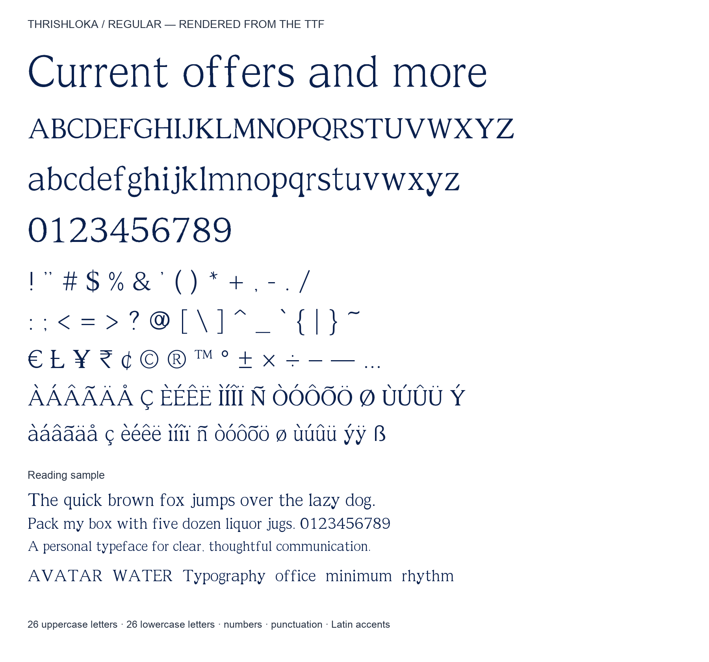

# Thrishloka

**A free, AI-assisted semi-serif font by Sneha, India.**

Thrishloka Regular has slightly condensed proportions, soft flares, restrained serifs and open counters. This is the **1.0.1 initial public preview**, licensed under the **SIL Open Font License 1.1** for personal and commercial use.

## Download and install

Download the complete ZIP from this repository's **Releases** section. For desktop use, install [`fonts/ttf/Thrishloka-Regular.ttf`](fonts/ttf/Thrishloka-Regular.ttf). On Mac, double-click it and choose Install in Font Book. On Windows, double-click it and choose Install. Reopen your application and select **Thrishloka**.

See [INSTALL.txt](INSTALL.txt) for Word instructions and [web/USE-ON-A-WEBSITE.txt](web/USE-ON-A-WEBSITE.txt) for the included WOFF2 web font.

## Included

- Regular weight, with separate uppercase and lowercase English letters.
- Numerals, standard keyboard punctuation, Latin-1 accents and selected symbols.
- 233 Unicode mappings and 236 glyphs; see [CHARACTER-SET.txt](CHARACTER-SET.txt).
- TrueType desktop font and WOFF2 web font.
- Kerning and combining-accent positioning.
- Source artwork, a build script, a specimen and release documentation.

## License

Copyright (c) 2026, Sneha.

The font software in this repository—including the fonts, source artwork, build scripts, specimen and documentation—is licensed under the **SIL Open Font License, Version 1.1**. Read [OFL.txt](OFL.txt) for the complete terms. **No Reserved Font Names are declared.** Third-party build dependencies are not bundled and retain their own licenses.

You may use the font in personal and commercial designs, embed it, modify it and redistribute it under the OFL conditions. Keep the copyright and license with redistributed font software. The font software may not be sold by itself. Documents and artwork made using it do not need to use the OFL. Previously drafted paid-license terms are not part of this release.

## Status and provenance

This is a working public preview, not a Google Fonts-approved or professionally audited typeface. Some letterforms originated as AI-generated artwork and were automatically traced into curves. Additional symbols were constructed as outlines. The design follows the publisher's approved Regular preview; see [SOURCE-NOTES.txt](SOURCE-NOTES.txt).

The release has a limited Latin character set, one weight, and no native bold or italic styles. It has not been tested inside desktop Word on both operating systems. Outline quality, spacing and small-size rendering can be refined further. See [VALIDATION.txt](VALIDATION.txt) for the checks actually performed. No claim of uniqueness against every existing font is made.

## Build and contribute

See [BUILD.txt](BUILD.txt) to rebuild the TTF and WOFF2 files. Report problems through this repository's Issues tab, including the application, operating system, text and font size. Include a screenshot when useful. Contributions to font software must preserve the OFL and notices; see [CONTRIBUTING.txt](CONTRIBUTING.txt).

## Release history

See [FONTLOG.txt](FONTLOG.txt). Font metadata version 1.001 corresponds to release 1.0.1.

The publishing walkthrough is in [PUBLISH-ON-GITHUB.txt](PUBLISH-ON-GITHUB.txt).
